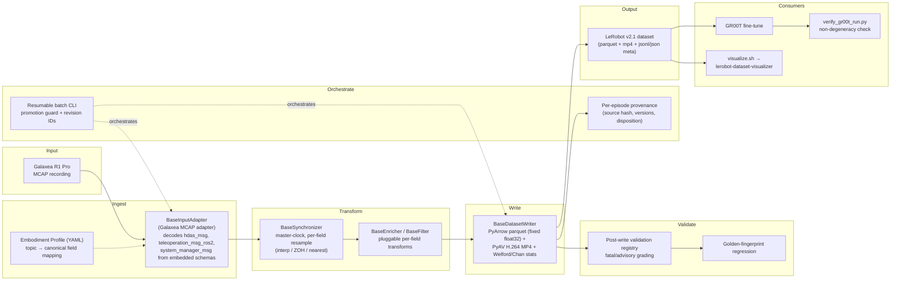

# Architecture

## Pipeline

## Modules

| Module | Role | Note |
|---|---|---|
| [`../contracts/`](../contracts/) | The cross-layer contract | Containers, protocols, and the embodiment profile schema — import everything from `data.contracts`, never a submodule (see [protocols.md](protocols.md)). |
| [`../adapters/galaxea.py`](../adapters/galaxea.py) | `GalaxeaInputAdapter` | Two-pass MCAP read: a CRC-validating index pass, then a streaming decode pass. |
| [`../adapters/checks.py`](../adapters/checks.py) | Ingest-time check registry | Fatal checks resolve from index-pass facts before any payload decode; advisory checks resolve from decode-pass facts and only downgrade disposition. |
| [`../sync/master_clock.py`](../sync/master_clock.py) | `MasterClockSynchronizer` | Builds the master-clock grid and resamples every other stream onto it per the profile's declared per-field policy. |
| [`../writers/lerobot_v21.py`](../writers/lerobot_v21.py) | `LeRobotV21Writer` | Streams a `CanonicalEpisode` to an on-disk LeRobot v2.1 dataset — parquet, MP4, and metadata. |
| [`../writers/modality.py`](../writers/modality.py) | Modality slice map | Generated from the same profile that drives the parquet schema, so `meta/modality.json` and the parquet feature layout can never drift apart. |
| [`../writers/stats.py`](../writers/stats.py) | Exact per-feature statistics | Welford/Chan online statistics — no approximation. |
| [`../validation/registry.py`](../validation/registry.py) + [`../validation/validate.py`](../validation/validate.py) | Post-write check registry | Structurally parallel to the ingest-time registry, independently defined — never runs any of the same code. |
| [`../provenance/recorder.py`](../provenance/recorder.py) | `ProvenanceRecorder` | Per-episode provenance record. Deliberately not a writer — no parquet/video dependency, so its schema versions independently of the LeRobot format. |
| [`../promotion.py`](../promotion.py) | Never-write-in-place guard | The output-prefix promotion guard, the run manifest, and the content-derived dataset revision identifier. |
| [`../cli.py`](../cli.py) | Batch entry point | Wires the whole loop: adapter → writer → provenance → validation, with resumability. |
| [`../run_config.py`](../run_config.py) | Run-config schema | The `--run-config` file's loader — batch knobs, deliberately separate from the embodiment profile. |
| [`../decoders.py`](../decoders.py) | JPEG decode seam | The pluggable `JpegDecoderBackend` registry, selected by name, not by import. |
| [`../tools/`](../tools/) | Standing tooling | `inspect_mcap.py` (read-only MCAP preflight), `measure_action_state_pairing.py` (action/state lag measurement), `verify_gr00t_run.py` (post-training non-degeneracy grading). |

## Concepts

**Master clock.** One camera declared `role: master_clock` in the profile *is* the timeline. Every other stream — state, action, secondary cameras — resamples onto the idealized `frame_index / fps` grid built from that camera's own buffered timestamps. No raw capture timestamp ever reaches an emitted frame.

**Per-field resample policy.** Each state/action field declares `interp`, `zoh`, or `nearest` in the profile. Continuous joints interpolate; discrete-ish actuators like grippers hold their last value (zero-order hold). The policy is declared per field, never inferred from the data.

**Bounded memory and the single pass.** A `CanonicalEpisode`'s frame stream is a generator (`Iterator[CanonicalFrame]`), consumed exactly once — a second iteration yields nothing. This is why `BaseEnricher` and `BaseFilter` take an `EpisodeHeader`, not an episode: an implementation needing frame-level inspection reads pre-computed summaries from `EpisodeHeader.global_meta`, or re-parses for a fresh generator. See [`../contracts/containers.py`](../contracts/containers.py) for the full reasoning.

**Four independent version axes.** `profile_hash` (the embodiment — changing it produces a new dataset revision and supersedes every prefix built under the old hash), `RUN_CONFIG_VERSION` (the run-knob file shape — never touches `profile_hash`), `PIPELINE_VERSION` and `RECORD_SCHEMA_VERSION` (the provenance side — freeze the code version and the on-disk provenance-record shape respectively). Each axis changes independently and for a different reason; conflating any two of them is a real, easy-to-make mistake.

**Fatal vs advisory checks.** Two registries with the same shape and no shared code. Ingest-time checks in [`../adapters/checks.py`](../adapters/checks.py) resolve from index-pass facts before any payload decode, so a failing fatal one aborts the episode before encode. Post-write checks in [`../validation/registry.py`](../validation/registry.py) all run regardless of earlier failures, so the report is always complete — no short-circuit.

**Never write in place.** Converting into an existing output prefix is guarded: this run's `(pipeline_version, profile_hash, format_key)` is compared against whatever is already recorded there, and a mismatch refuses the run rather than silently overwriting. Datasets get content-derived revision identifiers, and a changed profile hash supersedes every prefix built under the old one. See [`../promotion.py`](../promotion.py).
